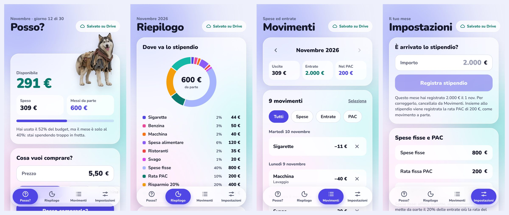

# Risparmio

Web app per iPhone che ti dice se puoi permetterti una spesa e ti aiuta a risparmiare ogni mese. I dati stanno solo sul tuo Google Drive.

**App:** https://gaggiafederico.github.io/Risparmio/

## Cosa fa

### Posso?
- Scrivi il prezzo, scegli la categoria e l'app risponde **"Sì, puoi"** o **"No, lascia stare"**, con il motivo.
- Il tasto **Sigarette** è il primo e propone già **5,50 €**. Ogni categoria può avere il suo prezzo proposto.
- In alto vedi il **disponibile** del mese, quanto hai **speso** e quanto è **messo da parte**.
- Se lo stipendio del mese non è ancora registrato, l'app te lo chiede qui.

### Riepilogo
- **Ciambella** con una fetta per ogni categoria in cui hai speso, più spese fisse, rata PAC, risparmio 20% e disponibile, con percentuali e importi.
- Spese **per categoria**, **sigarette in un anno** a questo ritmo, **piano di accumulo** (rata, versato finora, 13ª e 14ª).

### Movimenti
- Tutte le spese, gli stipendi, le rate PAC e le mensilità extra, mese per mese e divise per giorno.
- Filtri **Tutti / Spese / Entrate / PAC**.
- Cancelli un movimento con la **×**, oppure tocchi **Seleziona** e ne elimini diversi insieme.

### Impostazioni
- **È arrivato lo stipendio?**: registri lo stipendio quando arriva.
- **Spese fisse**, **rata fissa PAC** e **PAC già versato** (quanto avevi prima di usare l'app).
- **13ª e 14ª**, facoltative.
- **Categorie**: essenziale sì/no, limite al mese, prezzo proposto; puoi aggiungerle ed eliminarle.
- **Google Drive**: account collegato, **Prova collegamento**, **Esci da Google**, **Cambia ID client**.
- **Backup**: esporta o importa tutti i dati in un file.

## Come ragiona

| Voce | Regola |
| --- | --- |
| Entrate del mese | Stipendi registrati nel mese + 13ª/14ª arrivate nel mese. Lo stipendio è **sempre manuale**: non esiste uno stipendio fisso. |
| Messi da parte | **20% delle entrate + rata PAC** del mese. |
| Disponibile | Entrate − messi da parte − spese fisse − speso. |
| Rata PAC | Quando registri lo stipendio si crea anche il movimento "Rata PAC". Cancellando lo stipendio si toglie anche la sua rata. Se manca, il Riepilogo offre di registrarla. |
| Spese essenziali | Benzina, Macchina, Spesa alimentare, Medicine: sempre approvate (con avviso se intaccano il risparmio). |
| Sfizi | Approvati solo se c'è disponibile, restano dentro il 30% delle entrate, non vai troppo veloce rispetto al giorno del mese e non superi il limite della categoria. |
| Senza stipendio | Il disponibile resta vuoto e gli sfizi ricevono "Aspetta lo stipendio". |

### Il cane

Confronta la parte di budget già usata con la parte di mese già passata:

| Husky | Quando |
| --- | --- |
| In smoking | Hai usato meno budget di quanto mese è passato (meno dell'80% del ritmo). |
| Normale | Sei in linea con il mese. |
| Trasandato | Spendi più in fretta del mese, sei in rosso, o esageri con gli sfizi. |

Sotto la barra l'app scrive il motivo, per esempio "Hai usato il 52% del budget, ma il mese è solo al 40%".

## Dati e accesso

- **Solo Google Drive.** I dati stanno esclusivamente nel file `risparmio-dati.json` sul tuo Drive, mai sul telefono: Safari può cancellare i dati dei siti che non apri per 7 giorni. Ogni modifica viene salvata subito.
- **Più dispositivi.** Prima di ogni salvataggio l'app rilegge il file e unisce le modifiche fatte altrove, quindi nessuna spesa va persa. Le cancellazioni valgono su tutti i dispositivi.
- **Accesso ricordato.** Sul telefono restano solo l'account Google e l'ID client, non i dati. Google limita l'accesso dei siti senza server a un'ora: quando scade, il tocco successivo ti ricollega da solo, senza password, e completa l'azione. Riaprendo l'app trovi **Continua come …**.
- **Permessi minimi.** L'app chiede solo `drive.file`: vede esclusivamente il file che ha creato lei, non il resto del tuo Drive.
- **Test di collegamento.** All'accesso, e quando vuoi da Impostazioni, controlla passo per passo: accesso a Google, Drive raggiungibile, file, lettura, salvataggio. Se un passo fallisce, dice il motivo.

## Installazione

### 1. Pubblicare con GitHub Pages

1. Nel repository apri **Settings → Pages**.
2. In **Source** scegli **Deploy from a branch**, branch `main`, cartella `/ (root)`, e salva.
3. Dopo un minuto l'app è su `https://<utente>.github.io/Risparmio/`.

Ogni modifica caricata su `main` va online da sola in un paio di minuti, e l'app sul telefono si aggiorna da sola.

### 2. Creare l'ID client di Google (una volta sola)

1. Su [Google Cloud Console](https://console.cloud.google.com/) crea un progetto con il tuo account Gmail personale.
2. **API e servizi → Libreria**: attiva **Google Drive API**.
3. **Google Auth Platform → Pubblico** (o "Schermata consenso OAuth"): tipo utente **Esterno**, stato **Test**, e aggiungi il tuo Gmail tra gli **utenti di test**.
4. **Credenziali → Crea credenziali → ID client OAuth**, tipo **Applicazione web**. In **Origini JavaScript autorizzate** scrivi `https://<utente>.github.io` (senza `/Risparmio` e senza barra finale).
5. Copia l'**ID client** (finisce con `.apps.googleusercontent.com`). Il *client secret* non serve.

### 3. Primo avvio

1. Apri l'app: ti chiede l'**ID client**. Incollalo e tocca **Salva e continua**. La stessa schermata mostra l'indirizzo da autorizzare, con il tasto **Copia**.
2. Tocca **Accedi con Google**: parte il test di collegamento e poi si caricano i tuoi dati.
3. Al primo accesso Google può dire "Google non ha verificato questa app": è normale per un'app in test, tocca **Continua**.

L'ID client resta solo sul dispositivo dove lo inserisci, quindi il codice pubblicato non contiene niente di tuo. In alternativa puoi scriverlo in `config.js`, così è già pronto per chiunque apra il sito. Non è un segreto: Google lo accetta solo dall'indirizzo autorizzato.

### 4. Installare sull'iPhone

Apri il sito in Safari → **Condividi** → **Aggiungi alla schermata Home**.

### 5. Spese con Apple Pay (facoltativo)

In **Comandi Rapidi → Automazione → Nuova automazione → Transazione**, scegli le carte e **Esegui immediatamente**, poi:

1. **Codifica URL** sulla variabile *Esercente*.
2. **Testo**: `https://<utente>.github.io/Risparmio/?spesa=[Importo]&esercente=[URL codificato]`
3. **Apri URL** con quel testo.

Dopo ogni pagamento l'app si apre e chiede "Che spesa era?": tocchi la categoria e la spesa è registrata.

## Problemi comuni

| Messaggio | Soluzione |
| --- | --- |
| `Errore 403: org_internal` | Il progetto Google è impostato come **Interno**. In **Pubblico** premi **Rendi esterna**. Se non si può, crea il progetto con un Gmail personale, senza organizzazione. |
| `Errore 403: access_denied` | Aggiungi il tuo Gmail tra gli **utenti di test**. |
| `Errore 400: origin_mismatch` | L'origine autorizzata deve essere esattamente `https://<utente>.github.io`. |
| Test: "Permesso negato: controlla che Google Drive API sia attiva" | Attiva **Google Drive API** nel progetto. |
| Vedo ancora la versione vecchia | Chiudi del tutto l'app e riaprila. |

## File

| File | Cosa contiene |
| --- | --- |
| `index.html` | Struttura della pagina e barra in basso. |
| `app.js` | Tutta la logica: conti, schermate, Google Drive, test di collegamento, animazioni. |
| `style.css` | Stile: vetro, colori, animazioni (spente con "Riduci movimento"). |
| `config.js` | ID client di Google facoltativo. |
| `sw.js` | Service worker: carica sempre la versione nuova; quando cambi i file aumenta `VERSIONE`. |
| `manifest.webmanifest` | Nome, icona e colori per l'installazione. |
| `img/` | Icone dell'app e i tre husky. |
| `font/` | Font Nunito incluso. |

Per provarla sul computer: `python3 -m http.server 8000` nella cartella e apri `http://localhost:8000`. Per collegare Drive in locale aggiungi `http://localhost:8000` tra le origini autorizzate.

## Licenza

[MIT](LICENSE)
